<div align="center">

# TextExtractor Desktop

### Extract text from images. Privately, quickly, and offline.

A modern Windows OCR workspace for screenshots, scanned documents, and photos, powered by **Tesseract OCR** and **RapidOCR**.

   

**[Features](#features) · [Screenshots](#screenshots) · [Installation](#installation) · [Development](#development) · [Privacy](#privacy)**

</div>

---

## Overview

TextExtractor Desktop turns text embedded in images into editable, searchable, and reusable content. Import an image, select a region when needed, run OCR, and copy or save the result—all within a desktop interface. Recognition runs locally, without uploading your images to a cloud OCR service.

## Features

- **Multiple input methods:** open an image, drag and drop, capture a screenshot, or paste from the clipboard.
- **Region selection:** select the area of an image you want to recognize, with selection reset and undo/redo controls in the workspace.
- **Two OCR engines:** Tesseract and RapidOCR, with engine configuration available in Settings.
- **Editable results:** review and edit extracted text, copy all or a selection, search within the result, and save or share text.
- **History and favorites:** find earlier extractions, favorite useful results, and manage saved items.
- **Retention controls:** keep history until deletion or select automatic deletion periods.
- **Appearance settings:** follow the system theme or choose light or dark mode.
- **Privacy-first design:** local processing, no account requirement, and a privacy page explaining local storage and diagnostic behavior.

## Screenshots

### Home — import an image or capture a screenshot

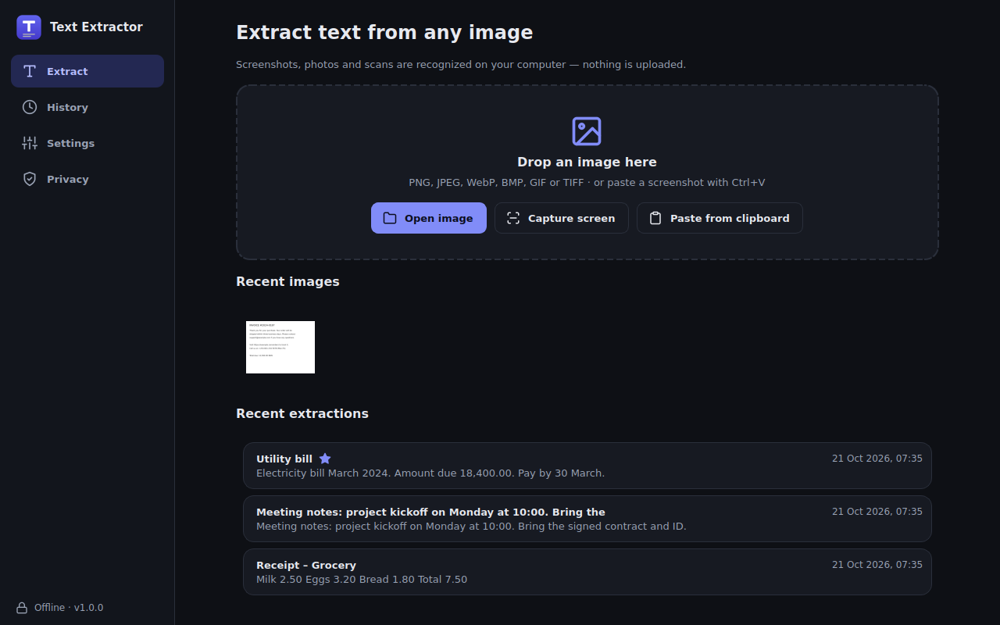

### Select the area to recognize

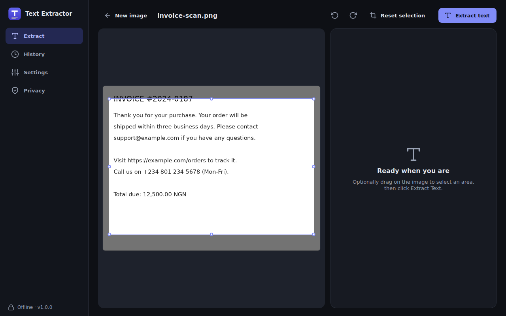

### Review, search, copy, and save extracted text

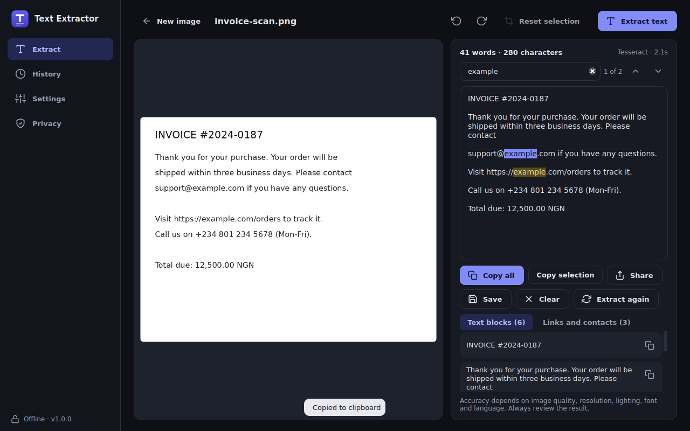

### History and favorites

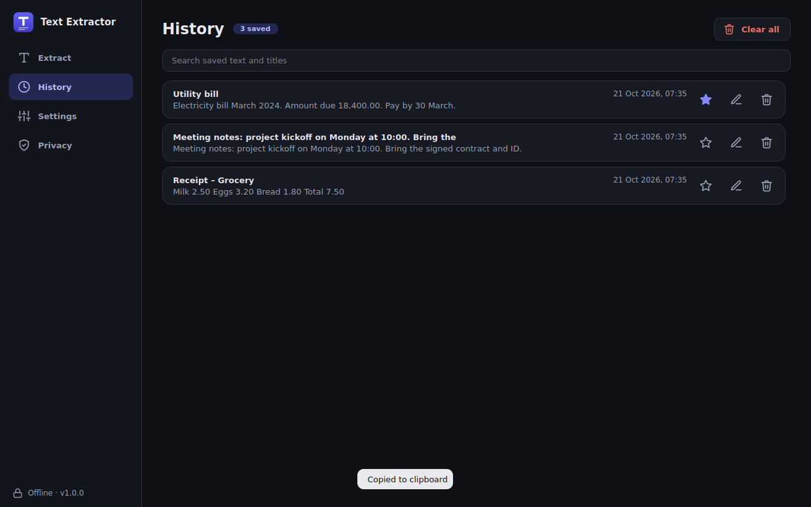

### OCR, language, appearance, and history settings

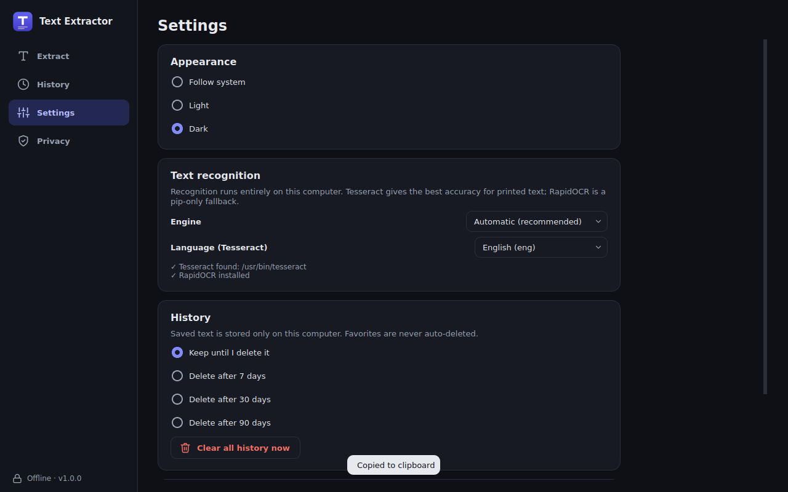

### Privacy information

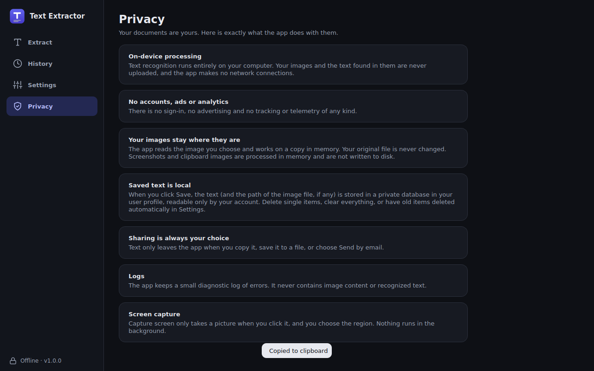

<details>
<summary><strong>View the light theme</strong></summary>

| Home | Workspace |
| --- | --- |
| 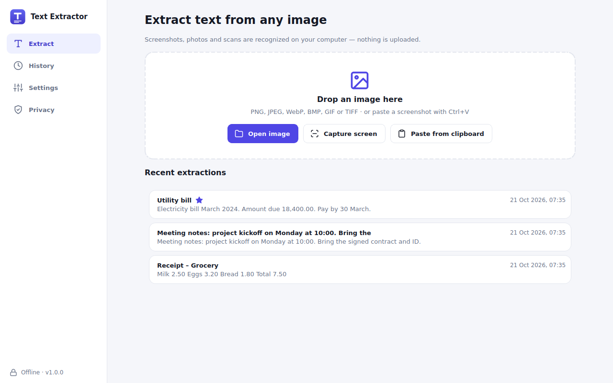 | 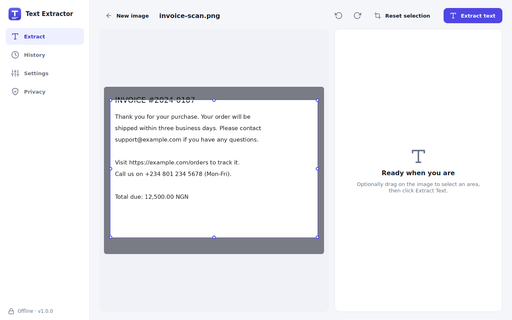 |

| Results | History |
| --- | --- |
| 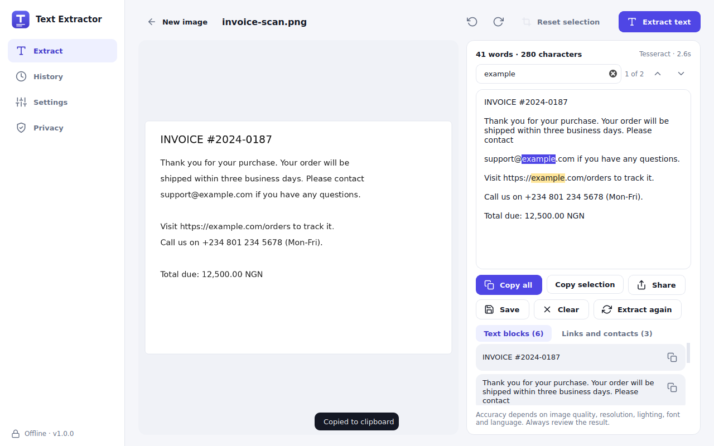 | 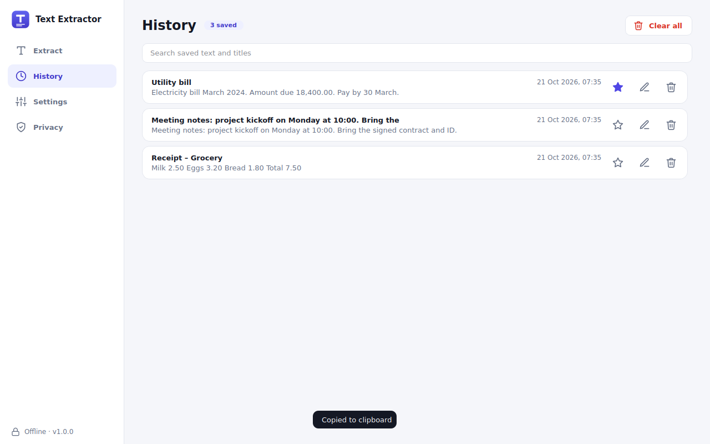 |

| Settings | Privacy |
| --- | --- |
| 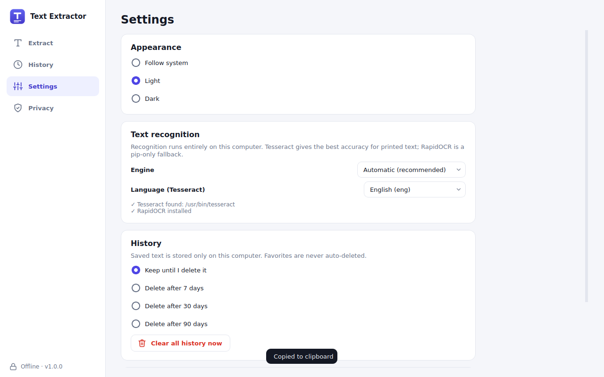 | 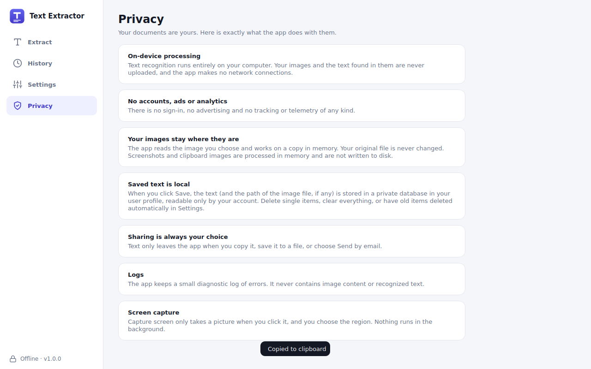 |

</details>

## Installation

### Windows installer (recommended)

1. Open the [Releases](../../releases) page.
2. Download the Windows installer attached to the latest published release, when available.
3. Run the installer and launch **TextExtractor Desktop**.
4. Open an image, select the desired region, and click **Extract text**.

A correctly packaged release includes the Python runtime and the OCR components needed for its supported engines. A source checkout does **not** automatically include Tesseract binaries.

### From source

**Requirements:** Windows, Python 3.10+, and Git. Tesseract OCR must be installed or made available separately if you intend to use that engine in development.

```powershell
git clone https://github.com/YOUR_USERNAME/TextExtractorDesktop.git
cd TextExtractorDesktop
py -m venv .venv
.\.venv\Scripts\Activate.ps1
python -m pip install --upgrade pip
python -m pip install -e ".[rapidocr]"
textextractor-gui
```

To use Tesseract during development, install a compatible [Windows build of Tesseract](https://github.com/UB-Mannheim/tesseract/wiki). If the application does not find it automatically, set `TEXTEXTRACTOR_TESSERACT` to the absolute path of `tesseract.exe` and restart the application.

> The optional RapidOCR dependency is declared in `pyproject.toml`. Some OCR model files may require separate packaging for fully offline distribution; verify the release on a clean Windows installation.

## How to use

1. **Import:** choose **Open image**, **Capture screen**, or **Paste from clipboard** (or drag an image onto the home screen).
2. **Select:** optionally drag across the image to focus recognition on a particular region.
3. **Extract:** click **Extract text** to run the configured OCR engine.
4. **Review:** edit, search, copy, save, or share the recognized text.
5. **Return later:** use **History** to find saved results or manage favorites.

## Development

The application is packaged as a Python project using a `src/` layout. The declared console and GUI entry points both resolve to `textextractor.app:main`.

| Component | Technology |
| --- | --- |
| Language | Python 3.10+ |
| Desktop UI | PySide6 / Qt |
| OCR engines | Tesseract OCR; optional RapidOCR |
| OCR inference | ONNX Runtime (RapidOCR) |
| Image handling | Pillow |
| Build tooling | PyInstaller (development dependency) |

Install the development dependencies and run tests:

```powershell
python -m pip install -e ".[rapidocr,dev]"
python -m pytest
```

For packaging, use the maintained scripts and configuration in `scripts/`, `packaging/`, and `installer/` as appropriate. A Windows release must include the native Tesseract executable, required DLLs, `tessdata` language files, and any required RapidOCR model assets. Test it on a machine without Python or Tesseract installed.

### Repository layout

```text
TextExtractorDesktop/
├── .github/                 # GitHub configuration
├── docs/
│   └── screenshots/         # Light and dark application screenshots
├── installer/               # Installer configuration
├── packaging/               # Application packaging files
├── scripts/                 # Development/build scripts
├── src/                     # Application source
├── tests/                   # Automated tests
├── .gitignore
├── LICENSE.txt
├── pyproject.toml
├── README.md
├── requirements.txt
└── THIRD_PARTY_NOTICES.md
```

Generated `build/`, `dist/`, `vendor/`, and `.venv/` directories are intended to remain outside source control. Publish installers as GitHub Release assets rather than committing them to the repository.

## Privacy

Text recognition is performed on-device. The application's privacy screen states that images and recognized text are not uploaded to a remote OCR service; saved text is stored locally and may be removed through history controls. Screen capture is initiated by the user. Review the in-app **Privacy** page for details about local data handling and diagnostic logs.

## Contributing and support

Bug reports, reproducible issues, and feature suggestions are welcome through [GitHub Issues](../../issues). For contributions, create a branch, make and test your changes, and submit a pull request describing the change.

## License and acknowledgements

See [LICENSE.txt](LICENSE.txt) for the application's license and [THIRD_PARTY_NOTICES.md](THIRD_PARTY_NOTICES.md) for third-party notices. Tesseract, RapidOCR, Qt/PySide6, Pillow, and ONNX Runtime are separate projects with their own applicable licenses.
